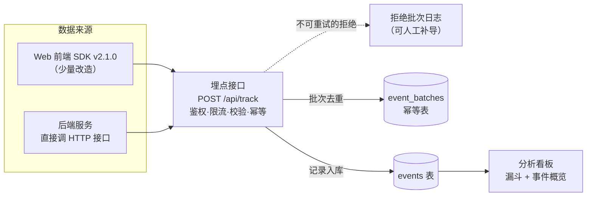

# 用户行为埋点与分析系统 技术架构设计（简化版）V0.2

> 输入：`docs/V0.1 BRD文档-1121.md`；需求确认时间：2026-11-21
> 本版按「用户量不大、聚焦收银台转化分析」重新精简，去掉 Kafka / Redis / ClickHouse / 对象存储 / 告警 / 分群画像等组件。
> V0.2 修订（2026-11-21）：修正幂等表结构、补齐记录类型/环境/维度字段、明确接口返回码契约与鉴权、定义漏斗口径、量化数据量假设与升级触发条件。修订原因见文末「附录 B：V0.1 → V0.2 修订说明」。

## 1. 背景与目标

公司多个系统需要采集用户行为，但没有统一的埋点 SDK 和分析系统。本期目标很聚焦：

> **看清买家在收银台各环节的转化率，定位流失环节。**

不做通用大型数据分析平台，先解决这一个问题。但**接口契约、表结构、SDK 接入方式必须按「多应用（多 appId）」设计**，避免第二个业务接入时重构。

## 2. 范围

| 模块 | 本期定位 |
|---|---|
| Web 前端埋点 SDK | **复用**已有 `flyway-track-sdk` v2.1.0，只做**极少量必要改造**（见 4.6），不做能力扩展 |
| 后端埋点接口 | **提供一个通用 HTTP 接口** `POST /api/track`，服务端调它上报关键事件（如支付成功），不提供复杂 SDK |
| 分析系统 | **一个漏斗看板 + 一个事件概览页** |
| 漏斗定义 | **配置化**（有序事件数组 + 过滤条件 + 窗口），不写死在代码里 |

取舍说明：

- **后端为什么不做 SDK**：服务端只需上报支付结果这类少量关键事件，一个 POST 足够；多语言 SDK 是纯成本，且服务端可信，不需要批量/重试/本地补发那套前端机制。
- **为什么去掉 Kafka / Redis / ClickHouse**：当前日事件量在 5 万行以内（见 11.1），MySQL 单表 + 索引足够。组件越少，出问题的面越小。升级触发条件见 11.2。
- **为什么范围先收缩到收银台**：BRD 要求"统一"，但一次做完所有场景必然失焦。本期是**试点**，先验证"埋点 → 漏斗 → 决策"这条链路能跑通，再横向复制。

数据来源：Web 前端（买家行为）+ 后端服务（支付结果）。

## 3. 总体架构



核心链路：SDK / 后端 → 一个接口 → 两张表（幂等表 + 事件表）→ 一个看板。

**隔离要求（重要）**：收银台是支付主链路，埋点接口必须与业务接口**连接池隔离**——使用独立 datasource（连接池上限 5~10）与独立线程池，接口自身超时 3s。埋点绝不能因为 DB 抖动挤占交易链路的连接。

## 4. 埋点协议

复用现有 `flyway-track-sdk` 的 batch 格式，后端接口按同一结构上报，保证数据格式一致。

### 4.1 请求体（真实样例，非简化）

```jsonc
{
  "appId": "flylinking-storefront",
  "sdkVersion": "2.1.0",
  "userId": "u_10086",              // 可为 null（未登录）
  "sessionId": "sess_1750000000000_ab12cd34e",
  "batchId": "batch_1750000000000_xy98zw76q",
  "sentAt": 1750000000000,          // 毫秒时间戳
  "context": {
    "url": "https://xxx.com/pay/123?token=***",
    "referrer": "https://xxx.com/order/123",
    "title": "Checkout",
    "userAgent": "Mozilla/5.0 ...",
    "language": "zh-CN",
    "screen":   { "width": 1920, "height": 1080 },
    "viewport": { "width": 1440, "height": 900 },
    "devicePixelRatio": 2
  },
  "batch": [
    { "type": "event", "timestamp": 1750000000000,
      "data": { "event": "cashier_view", "properties": { "orderId": "...", "payAmount": 199.9, "currency": "USD" } } },
    { "type": "performance", "timestamp": 1750000000100,
      "data": { "stage": "load", "metrics": { } } }
  ]
}
```

### 4.2 记录类型（`batch[].type`）

SDK 的上报队列**不只包含 event**，`error` / `performance` / `page_stay` 走同一个队列、同一个 batch，可能混批发送。

| type | `data` 关键字段 | 本期处理 |
|---|---|---|
| `event` | `event`, `properties` | 全量落库，漏斗只认它 |
| `performance` | `stage`, `metrics` | 落库（`record_type` 标记），不参与漏斗；噪音大时可关闭 |
| `page_stay` | 停留信息 | 同上，建议关闭 |
| `error` | 错误信息 | 落库（`record_type` 标记），可辅助排障 |

**服务端不得假设 `data.event` 一定存在**，否则非 event 记录会让整批插入失败（连带同批关键事件丢失）。

### 4.3 传输约定（与 SDK 实现对齐，勿改）

- `Content-Type: text/plain;charset=UTF-8`——这是**有意为之**：属于 CORS 简单请求，避免预检失败导致数据静默丢失，同时保证 `sendBeacon` 卸载期数据可用。**服务端必须按原始 body 解析 JSON，不要依赖 Content-Type 判断，也不要改前端为 `application/json`。**
- 三通道降级：`sendBeacon`（页面隐藏时）→ `fetch`（`keepalive: true`, `credentials: omit`）→ `XHR`。
- 响应**必须带 CORS 头**：`Access-Control-Allow-Origin: <白名单域名>`、`Access-Control-Allow-Methods: POST, OPTIONS`。缺了会导致 fetch 读不到状态码，重试逻辑整体退化。
- 上报地址走**独立子域**（如 `track.<公司域名>`），与业务站点分离，便于独立限流与故障隔离。

### 4.4 批次大小上限

| 限制项 | 取值 | 超限行为 |
|---|---|---|
| 单请求 body | ≤ 256 KB | 拒绝，返回 200 + 丢弃 + 记日志（见 5.2） |
| 单 batch 记录数 | ≤ 50 条 | 同上 |
| `batch[].data` 大小 | ≤ 16 KB | 单条丢弃，其余正常入库 |

SDK 侧默认 `batchSize: 10`、`maxQueueSize: 200`，正常情况下不会触发上限；上限只用于防护异常调用。

### 4.5 幂等与去重

- `batchId` 由 SDK **每批生成一次**，重试（fetch 内部循环）复用同一 payload，故同一 `batchId` 天然对应同一批记录。
- 幂等实现：`event_batches` 表以 `batch_id` 为主键，插入冲突即视为重复批次，**直接返回 200**（不返回 409，否则会触发无意义重试）。
- **已知限制**：SDK 的 localStorage 失败补发（`persistFailedBatch`）只持久化 `records`，**不保存 batchId**，跨页面重发时会重新生成 batchId。因此「服务端已写入但响应丢失」的场景下重发会产生重复数据。本期通过 4.6 的 SDK 小改造修复；在改造上线前，漏斗统计按 `(session_id, event)` 去重以兜底。

### 4.6 SDK 必要改造（3 处，均为小改动）

"复用不改造"在实现上不成立，以下三处必须改，否则数据不可信：

| # | 改造点 | 目的 |
|---|---|---|
| 1 | `persistFailedBatch` 时把 `batchId` 一并冻结（`list.push({ batchId, ts, records })`），`resumeFailedBatches` 复用该 batchId | 保证补发幂等，避免重复入库 |
| 2 | `fetchReport` 对 **4xx 短路**（不重试、不持久化），仅 5xx / 网络错误重试 | 避免永久性失败造成无限重试 |
| 3 | 请求头补充 `X-Track-App-Id` / `X-Track-Sent-At` / `X-Track-Sign`（见 5.3） | 提供最低限度的来源可信度 |

除此之外不改 SDK 的行为、不新增能力。

## 5. 埋点接收接口

单接口，逻辑尽量薄：

| 步骤 | 处理 | 失败时 |
|---|---|---|
| 1 | 校验 `env` / `appId` 是否在配置白名单 | 拒绝（200 + 丢弃 + 日志） |
| 2 | 校验签名与 `sentAt` 时间窗（±5 分钟） | 拒绝（200 + 丢弃 + 日志 + `rejected` 指标） |
| 3 | 限流（单 IP / 单 appId） | 429（SDK 会重试，可接受） |
| 4 | 按原始 body 解析 JSON、校验批次大小上限 | 拒绝（200 + 丢弃 + 日志） |
| 5 | 插入 `event_batches`；主键冲突 → 重复批次，**返回 200** | — |
| 6 | 展开 batch，逐条校验；非法记录**单独跳过**（不能整批失败） | 记录 `rejected_records` 指标 |
| 7 | 单条 multi-row `INSERT` 批量写入 `events`（同一事务） | 返回 503，由 SDK 重试 |
| 8 | 返回 200 | — |

### 5.1 关键原则

- **批次写入是一个事务**：`event_batches` 与 `events` 同事务提交，避免"幂等表已写入但事件未入库"导致该批永久丢失。
- **个别记录非法不能整批失败**，否则一条脏数据会拖死整批关键事件。
- 「重复批次」和「被拒绝批次」都必须返回 200，让客户端认为已送达。

### 5.2 返回码契约（必须实现，否则客户端会无限重试）

SDK 对**任何非 2xx 都重试**（3 次指数退避），重试耗尽后写入 localStorage，下次页面加载继续补发。因此服务端必须区分「可重试」与「不可重试」：

| 场景 | HTTP | 客户端行为 | 数据去向 |
|---|---|---|---|
| 正常入库 / 重复批次 | 200 | 成功 | 入库 |
| 未授权 appId、签名失败、时间窗超时 | **200** | 成功（避免死循环） | 丢弃 → WARN 日志 + `rejected` 指标 |
| JSON 非法、body 超限、batch 超限 | **200** | 成功 | 丢弃 → WARN 日志（含 body 前 2KB 摘要） |
| 个别记录字段非法 | **200** | 成功 | 跳过该记录，其余入库 |
| 限流触发 | 429 | 重试 | 延迟入库 |
| DB 不可用 / 写入超时 | **503** | 重试 + 本地补发 | 待重试 |

被丢弃的批次写一行结构化 WARN 日志（`appId / batchId / 原因 / body 摘要`），保留 7 天，作为**最后兜底的人工补导来源**。

### 5.3 鉴权（最低限度，务必实现）

`appId` 在前端 JS 中明文可见，"白名单"本身不构成防护——任何人都能拿它 POST 假 `pay_success` 把漏斗刷满。分层处理：

1. **独立域名 + HTTPS**，与业务站点分离。
2. **多 appId 隔离**：每个应用独立 `secret`，泄露只影响单个应用且可单独轮换。
3. **签名**：SDK 计算 `X-Track-Sign = HMAC_SHA256(secret, appId + "." + sentAt + "." + rawBody)`，服务端校验 + `sentAt` ±5 分钟时间窗防重放。
4. **限流**：单 IP 600 req/min、单 appId 总 QPS 上限（按 11.1 量级取 50 QPS 足够）。
5. **数据侧异常检测**：`pay_success` 小时增量突变、单 session 重复 `pay_success` 计数告警。

> 说明：前端持有 `secret` 意味着签名只能**提高伪造门槛 + 便于定位来源**，无法防御逆向。真正的防线是第 4、5 条。这一点必须写明，避免团队误以为签名等于安全。

## 6. 数据存储

MySQL 8.0（公司通常已有，零新增组件）。**两张表**：幂等表 + 事件表。

> V0.1 的 `UNIQUE KEY uk_batch (batch_id)` 放在 `events` 上是错误的：一个 batch 展开后是多行，`batch_id` 相同，唯一索引会让每批只剩 1 行入库、其余静默丢弃。必须按下面结构拆分。

```sql
-- 幂等表：一个批次一行
CREATE TABLE event_batches (
  batch_id     VARCHAR(64)  NOT NULL,
  app_id       VARCHAR(64)  NOT NULL,
  env          VARCHAR(16)  NOT NULL,
  record_count INT          NOT NULL,
  received_at  DATETIME(3)  NOT NULL,
  PRIMARY KEY (batch_id),
  KEY idx_app_time (app_id, env, received_at)
) ENGINE=InnoDB DEFAULT CHARSET=utf8mb4;

-- 事件表：一条记录一行
CREATE TABLE events (
  id          BIGINT AUTO_INCREMENT PRIMARY KEY,
  batch_id    VARCHAR(64)  NOT NULL,
  app_id      VARCHAR(64)  NOT NULL,
  env         VARCHAR(16)  NOT NULL,          -- prod / test / staging，防止测试数据污染生产漏斗
  record_type VARCHAR(16)  NOT NULL DEFAULT 'event',  -- event / performance / page_stay / error
  event       VARCHAR(64)  NULL,              -- 非 event 类型为 NULL，故不允许 NOT NULL
  user_id     VARCHAR(64)  NULL,              -- 未登录为 NULL
  session_id  VARCHAR(64)  NOT NULL,
  order_id    VARCHAR(64)  NULL,              -- 从 properties 提取，用于订单级排查
  wallet_type VARCHAR(32)  NULL,              -- 从 properties 提取，漏斗筛选维度
  fail_reason VARCHAR(64)  NULL,              -- 从 properties 提取，流失归因
  properties  JSON         NULL,
  occurred_at DATETIME(3)  NOT NULL,          -- 客户端时间（UTC），用于行为时序
  received_at DATETIME(3)  NOT NULL,          -- 服务端时间（UTC），用于对账与趋势
  KEY idx_app_event_time (app_id, env, event, occurred_at),
  KEY idx_session_event  (session_id, event, occurred_at),
  KEY idx_batch          (batch_id)
) ENGINE=InnoDB DEFAULT CHARSET=utf8mb4;
```

设计要点：

1. **查询维度不埋在 JSON 里**：`wallet_type` / `fail_reason` / `order_id` 在应用层解析 `properties` 后写入独立列。MySQL 的 `JSON` 列**无法直接建索引**，若把钱包类型筛选留在 JSON 里，漏斗页每次刷新都是全表扫。
2. **`env` 必须隔离**：测试环境接入 SDK 会直接污染生产漏斗，这是埋点系统最常见的线上事故。
3. **两个时间字段**：`occurred_at` 取自客户端 `Date.now()`，可被改系统时间，用于行为时序；`received_at` 取服务端时间，用于趋势与对账。**两者都存 UTC**。
4. 按 `session_id` 聚合可还原单次收银台会话的完整路径；按 `(app_id, env, event, occurred_at)` 查事件量趋势。
5. 数据量变大后按 11.2 的触发条件再演进，本期不做分区与归档。

## 7. 收银台埋点方案与转化漏斗

### 7.1 事件清单

按收银台实际流程定义（对应现有支付页 `/pay/[id]`）：

| 环节 | 事件名 | 触发时机 | 上报端 |
|---|---|---|---|
| 1 进入收银台 | `cashier_view` | 订单详情页加载完成 | 前端 |
| 2 选择支付方式/钱包 | `wallet_select` | 用户选中某个钱包 | 前端 |
| 3 钱包连接成功 | `wallet_connected` | 钱包连接成功回调 | 前端 |
| 4 点击支付 | `pay_click` | 用户点击 Pay 按钮 | 前端 |
| 5 支付成功 | `pay_success` | 服务端确认支付成功 | **后端** |
| 流失 | `pay_failed` | 支付失败（带失败原因） | **后端** |

事件命名统一 `snake_case`，`properties` 字段统一 `camelCase`（与现有 SDK/前端代码一致），字段变更需更新本文档的字段字典。

### 7.2 字段字典

| 事件 | properties 必填字段 | 可选字段 |
|---|---|---|
| `cashier_view` | `orderId`, `payAmount`, `currency` | `payMethodList` |
| `wallet_select` | `orderId`, `walletType` | `walletName` |
| `wallet_connected` | `orderId`, `walletType` | `chainId`, `connectDurationMs` |
| `pay_click` | `orderId`, `walletType`, `payAmount`, `currency` | `fxRate` |
| `pay_success` | `orderId`, `walletType`, `payAmount`, `currency`, `txHash` | `chainId` |
| `pay_failed` | `orderId`, `walletType`, `failReason` | `errorCode`, `chainId` |

**禁止上报字段**（服务端黑名单过滤 + 前端规范双保险）：卡号、CVV、完整邮箱/手机号、身份证号、私钥/助记词、URL query 中的 token。钱包地址允许上报，展示时截断。

### 7.3 漏斗口径（必须先对齐，否则数字不可用）

| 口径项 | 本期定义 |
|---|---|
| 统计主体 | **`session_id` 为主口径**（未登录也能算）；`user_id` 仅用于筛选与明细展示 |
| 转化判定 | 同一 `session_id` 内，各步骤按 `occurred_at` **升序**依次出现即算推进 |
| 步骤窗口 | 相邻两步最大间隔 30 分钟（与 SDK 的 session 超时一致），默认开启 |
| 跨会话转化 | **本期不支持**（"今天进、明天付"不算转化），明确写死，避免后续口径漂移 |
| 步骤内去重 | 同一步骤重复触发只计 1 次（`COUNT(DISTINCT session_id)`） |
| 时区 | 存储统一 UTC；看板按 `app.timezone`（默认 `Asia/Shanghai`）换算后再按天/小时分组 |
| 数据来源 | 仅 `record_type = 'event' AND event IS NOT NULL AND env = 'prod'` |

漏斗指标：每步**到达人数**、**相对上一步转化率**、**相对首步总转化率**。点某一步可下钻查看该 session 的完整事件序列与 `properties`（失败原因、钱包类型等）。

### 7.4 漏斗配置化

漏斗不写死在代码里，用一个配置文件描述（MVP 阶段放 `config/funnels.yaml` 即可，无需新建表）：

```yaml
- key: cashier_conversion
  name: 收银台转化
  appId: flylinking-storefront
  steps: [cashier_view, wallet_select, wallet_connected, pay_click, pay_success]
  filters: { env: prod }
  windowMinutes: 30
```

第二个业务接入时只加一段配置，不改代码。

## 8. 分析系统功能

两个页面：

1. **转化漏斗页**（主页面）
   - 选择时间范围、应用、钱包类型等维度
   - 展示漏斗各步骤人数与转化率
   - 点击某一步查看流失会话明细（事件序列 + properties）

2. **事件概览页**
   - 各事件的触发量、独立用户数趋势
   - 按天/小时折线图

技术实现：Vue 3 + Element Plus + ECharts；后端提供两个查询接口（漏斗、事件概览），直接查 MySQL 聚合即可，不需要单独查询引擎。

## 9. 技术选型与部署

| 组件 | 选型 |
|---|---|
| 前端 SDK | 已有 `flyway-track-sdk` v2.1.0（复用，仅按 4.6 改造 3 处） |
| 埋点接口 | 沿用公司现有技术栈（如 Java Spring Boot），单接口 + 独立连接池 |
| 存储 | MySQL 8.0，两张表（`event_batches` / `events`） |
| 分析后台 | Vue 3 + Element Plus + ECharts |
| 部署 | 应用服务 + MySQL，Docker Compose 或现有环境即可 |

无新增中间件，运维成本最低。

**接入配置**：SDK 默认 `serverUrl` 为占位域名（`https://your-analytics-server.com/api/track`），上线时必须替换为真实地址 `https://track.<公司域名>/api/track`；`appId` 按应用分配，`env` 随构建注入。

## 10. 实施计划

1. 定稿收银台事件清单与 `properties` 字段字典（本文档 7.1 / 7.2）
2. 建表 + 实现 `POST /api/track`（含鉴权、限流、幂等、返回码契约、独立连接池）
3. 前端接入 SDK（配置真实 `serverUrl` / `appId` / `env`），在支付页按环节加 `track()`；按 4.6 改造 3 处
4. 后端在支付成功/失败处补上报（服务端直接调用同一接口）
5. 实现漏斗页 + 事件概览页（漏斗读配置文件）
6. 加最基础的监控（见 11.3），灰度观察 1 天数据完整性
7. 上线首周看转化率数据，再决定是否扩大范围

## 11. 非功能设计

### 11.1 数据量假设（可验证，不是"量不大"）

| 项 | 假设值 |
|---|---|
| 收银台日访问订单数 | ≤ 2,000 |
| 单订单事件数（含 6 个业务事件 + 基础事件） | ≤ 10 |
| 日事件行数 | ≤ 20,000 |
| 年事件行数 | ≤ 750 万 |
| 写入 QPS 峰值 | < 20 |
| 漏斗查询扫描行数（7 天） | < 20 万 |

结论：MySQL 单表 + 上述索引完全足够。

### 11.2 升级触发条件（写死阈值，避免反复争论）

| 条件 | 动作 |
|---|---|
| `events` 行数 > 3,000 万 | 加「按天预聚合表」（`daily_event_metrics`，定时任务），看板改读聚合表 |
| 漏斗查询 P95 > 2s | 同上（预聚合） |
| 日事件行数 > 50 万 | 同上，并评估分区表 |
| `events` 行数 > 1 亿 或 需多维自由分析 | 引入 ClickHouse，接口保持协议不变、只换写入/查询实现 |

### 11.3 可观测性（去告警 ≠ 去掉自检）

埋点系统最典型的故障是**静默失效**（配置错、域名解析变、CORS 挂），漏斗全是 0 但三天无人发现。至少具备三条：

1. `POST /api/track` 5xx 率 > 0.1% 持续 5 分钟 → 告警
2. 近 1 小时入库量环比下跌 > 50% → 告警
3. `rejected` 计数（批次 / 记录级）突增 → 告警

不做复杂告警平台，复用现有监控即可；三条指标落库/打点即可，成本极低。

### 11.4 数据保留与归档（本期只定策略，不做实现）

- 原始事件保留 **12 个月**。
- 超过 12 个月按月导出冷存储后删除（本期可用 `mysqldump` + 手工归档，不建对象存储）。
- 提供按 `orderId` / `sessionId` 删除能力，用于合规申诉与误报数据清理。

## 附录 A：本期明确不做（含触发条件）

| 不做项 | 触发条件 |
|---|---|
| 实时（秒级）数据 | 业务明确需要实时监控支付成功率，且 MySQL 写入延迟不可接受 |
| Kafka / 消息队列 | 写入 QPS > 500 或出现接口超时导致交易链路受影响 |
| Redis 缓存/去重 | 幂等表成为瓶颈（单表 > 1 亿行） |
| 分群、画像、留存、路径分析 | 漏斗验证有效，且业务提出明确的第二个分析诉求 |
| 采样 | 日事件 > 50 万后为控成本再评估（采样会破坏漏斗准确性，慎用） |
| 多场景漏斗 | 第二个业务接入时（漏斗已配置化，只需加配置与事件字典） |
| 数据看板权限体系 | 接入非内部人员时 |

## 附录 B：V0.1 → V0.2 修订说明

| # | V0.1 的问题 | 影响 | V0.2 处理 |
|---|---|---|---|
| 1 | `events` 表 `UNIQUE KEY uk_batch (batch_id)` | 一批多行共享 batchId，每批只剩 1 行入库 | 拆出 `event_batches` 幂等表，`events` 改普通索引 |
| 2 | `event VARCHAR(64) NOT NULL` | SDK 会发 `performance` / `error` / `page_stay`，无 `event` 字段 → 整批插入失败 | 加 `record_type`，`event` 允许 NULL |
| 3 | "写入失败返回非 200，SDK 重试" | SDK 对 4xx 也重试 + 本地补发，永久性失败会无限重试 | 明确返回码契约（5.2）；SDK 对 4xx 短路（4.6） |
| 4 | "batchId 唯一索引做幂等" | SDK 补发不保存 batchId，重发会重复入库 | 冻结 batchId（4.6）+ 漏斗按 `(session_id, event)` 兜底去重 |
| 5 | 无鉴权 | 任何人可伪造 `pay_success` 刷高转化率 | 签名 + 时间窗 + 限流 + 异常检测（5.3） |
| 6 | 无漏斗口径定义 | 人数/转化率无法复现，后续口径漂移 | 新增 7.3 口径表 |
| 7 | 无 `env` 字段 | 测试数据污染生产漏斗 | 新增 `env`，并写入协议与索引 |
| 8 | 查询维度埋在 JSON | 按钱包类型筛选需全表扫 | 提升 `wallet_type` / `fail_reason` / `order_id` 为独立列 |
| 9 | 只有客户端时间 | 用户改系统时间会污染趋势 | 增加 `received_at`，统一 UTC |
| 10 | "用户量不大"无量化 | 无法验证单表方案，升级时点靠拍脑袋 | 11.1 数据量假设 + 11.2 触发阈值 |
| 11 | 漏斗硬编码收银台事件 | 第二个业务接入需改代码 | 漏斗配置化（7.4） |
| 12 | 埋点与业务共用连接池 | DB 抖动时埋点挤占交易链路 | 独立 datasource / 线程池 + 3s 超时 |
| 13 | 无监控 | 数据静默中断无人发现 | 11.3 三条最基础指标 |
| 14 | 缺隐私与字段字典 | 收银台会带钱包地址/金额/订单号，合规风险 | 7.2 字段字典 + 禁止字段黑名单 + 保留期 |
| 15 | 协议 `context` 字段不全、路径写成 `/track` | 后端实现者会按简化版写，漏采集与路由不符 | 4.1 贴真实样例、4.3 对齐实际默认值 |

## 附录 C：V0.3 统计维度增补（2026-11-21）

V0.2 只做了业务事件漏斗。本次补上「页面性能 / 停留时长 / UA / 国家地区」四类维度，并对齐了原有设计里的一处缺口。

### C.1 修复的缺口

SDK 一直在批次层上报 `context`（`url / referrer / title / userAgent / language / screen / viewport`），但 V0.2 的服务端**只存 `batch[].data`，把整个 `context` 丢弃**。表现为：客户端上报成功、接口返回 200、库里查不到 UA 与页面 —— 属于静默丢数据。

处理方式：

1. `context` 落 `event_batches`（批次级，一份）
2. `country / device_type / url_path` 冗余进 `events`，供漏斗与概览做高频筛选
3. 出现协议未登记字段时打 `unknown_payload_fields` WARN 日志，避免以后再静默丢

### C.2 新增字段

| 表 | 字段 | 来源 |
|---|---|---|
| `event_batches` | `ip` / `country` / `region` | 网关透传请求头（服务端不做 GeoIP 反查） |
| `event_batches` | `ua` / `device_type` / `os` / `browser` | `context.userAgent`（回退到请求头），服务端用 ua-parser-js 解析 |
| `event_batches` | `url_path` / `referrer` / `lang` | `context.url`（**去掉 query**）/ `context.referrer` / `context.language` |
| `events` | `country` / `device_type` / `url_path` | 冗余自上表，用于维度筛选 |
| `events` | `perf_stage` / `fcp_ms` / `lcp_ms` / `ttfb_ms` / `load_ms` / `inp_ms` / `cls_score` / `stay_ms` | **生成列**，从 `properties` 物化，写入代码零改动 |

### C.3 网关透传约定

| 用途 | 配置项 | 默认优先级 |
|---|---|---|
| 客户端 IP | `CLIENT_IP_HEADERS` | `x-real-ip` → `x-forwarded-for` → `x-client-ip` |
| 国家 | `GEO_COUNTRY_HEADERS` | `cf-ipcountry` → `x-client-geo-country` → … → `x-client-geo-loc` |
| 地区 | `GEO_REGION_HEADERS` | `x-client-geo-region` → `x-geo-region` → `x-region` |

国家值统一归一化为 ISO 3166-1 alpha-2，兼容 `CN` / `cn` / `CN,Beijing`（阿里云 loc 头）/ `CN-Beijing` 四种形态；非法值写 NULL，不写脏数据。

### C.4 新增接口

| 方法 | 路径 | 用途 |
|---|---|---|
| GET | `/api/experience/performance` | 性能指标分位数（LCP/FCP/TTFB/Load/INP/CLS）+ 按页面/国家/设备分组 |
| GET | `/api/experience/stay` | 停留时长分位数 + 按页面/结束原因分组 |
| GET | `/api/meta/integrity` | 批次声明条数 vs 实际入库行数，发现静默丢数据 |

漏斗与概览接口新增 `country` / `deviceType` 两个筛选参数。

### C.5 口径说明（看数字前必须知道）

| 项 | 口径 |
|---|---|
| 性能样本 | 只统计 `record_type='performance'`；`sessions` 取 `stage='final'` 的会话数 |
| 分位数 | MySQL 无 `PERCENTILE_CONT`，用 `ROW_NUMBER` + `CEIL(total * p)` 取第 N 个值；**不是插值分位** |
| CLS | 无量纲分数，单位记为 `score`，不要和毫秒混排比较 |
| 停留时长 | 只统计 `page_stay`；SDK 对不足 1 秒的片段不上报，`stayTime` 是**可见态分段**，不是墙钟时间 |
| 国家/设备 | 取自批次级上下文，因此同一批次的记录共享同一国家；缺失时该维度分组键为 NULL |
| 逐桶独立用户 | 概览页的独立用户是各时间桶去重后求和，非全区间去重 |
## 附录 D：看板登录与应用管理（2026-11-21）

附录 A 把「数据看板权限体系」列为不做项，触发条件是「接入非内部人员时」。本期提前落地，原因有两条：查询接口已经在暴露生产转化数据；应用密钥此前只能改环境变量再重启，泄露后无法快速轮换。

### D.1 登录方式

两种入口，同一个飞书授权页，区别只在呈现：

| 方式 | 前端 | 回调落地 |
|---|---|---|
| 扫码登录 | `/login` 页 iframe 内嵌 `https://passport.feishu.cn/suite/passport/oauth/authorize?client_id&redirect_uri&response_type=code&state` | 回调发生在 iframe 内，后端返回极简页用 `postMessage` 把 token 交给父窗口 |
| 授权登录 | 整页跳转到同一地址（手机端 / iframe 被拦时兜底） | 后端 302 到 `${WEB_ORIGIN}/login/callback#token=...`，token 放 fragment，不进服务端日志与 Referer |

要点：

1. **state 一次性**：32 位 hex，5 分钟有效，落 `auth_login_states`；消费用 `DELETE` 的影响行数判定，并发回调只有一次能通过。
2. **token**：32 字节随机 base64url，库里只存 `sha256`；默认 168 小时（`SESSION_TTL_HOURS`）。
3. **传输用 `Authorization: Bearer` 而不是 cookie**：埋点接口的 CORS 是 `credentials:false` + 允许 `*`，用 cookie 会逼着收紧来源白名单；Bearer 只需放行 `authorization` 头与 `PATCH/DELETE`。
4. **角色**：`admin` / `viewer`。判定顺序为 `ADMIN_BOOTSTRAP_OPEN_IDS` 白名单 → 库里没有任何可用管理员时首个登录者自动成为管理员（一次性引导）→ 其余默认 `viewer`。
5. 用户被停用后，已有 token 立即失效（每次请求都会查用户状态）。

### D.2 应用管理

- 表 `analytics_apps`：`app_id`（`名称 slug-8 位 hex`，如 `storefront-1a2b3c4d`）、`secret`（48 位 hex）、`env`、`status`、`remark`、`created_by`。
- **密钥只在创建/轮换时明文返回一次**，列表接口只回掩码（`3f1a****b9c2`）。
- **验签来源优先级：`analytics_apps` > `APP_SECRETS`**。环境变量里的存量应用在页面上标记为 `env`、只读，不能轮换或删除，避免出现「两个地方各有一份密钥」。
- 缓存 30 秒；新增/轮换/停用会显式 `invalidate`，所以变更立即生效。DB 故障时进入 5 秒冷却并用环境变量兜底，兜不住则让上报返回 503（由 SDK 重试，不丢数据）。
- 停用后验签按 `unknown_app_id` 处理：返回 200 + 丢弃 + WARN 日志，不触发重试。
- 删除是物理删除，历史事件全部保留。

### D.3 新增接口

| 方法 | 路径 | 说明 |
|---|---|---|
| GET | `/api/auth/config` | 登录页判断展示方式（是否配置飞书、是否允许本地登录、是否强制登录） |
| GET | `/api/auth/feishu/login-url?mode=qr\|redirect` | 返回飞书授权页地址与 state |
| GET | `/api/auth/feishu/callback` | 飞书回调（公开） |
| GET | `/api/auth/me` | 当前用户 |
| POST | `/api/auth/logout` | 退出登录 |
| POST | `/api/auth/dev-login` | 本地调试登录，生产恒不可用 |
| GET | `/api/admin/apps` | 应用列表 + 签名参数 |
| POST | `/api/admin/apps` | 颁发应用，返回明文密钥（仅此一次） |
| PATCH | `/api/admin/apps/:appId` | 改名 / 改环境 / 停用启用 / 备注 |
| POST | `/api/admin/apps/:appId/rotate` | 轮换密钥 |
| DELETE | `/api/admin/apps/:appId` | 删除应用 |
| GET | `/api/admin/users` | 成员列表 |
| PATCH | `/api/admin/users/:id` | 改角色 / 停用启用 |

鉴权在 `onRequest` 钩子统一处理：`/api/*` 默认要求登录，`/api/admin/*` 额外要求管理员；公开路径只有 `/api/track`、健康检查、`/api/auth/config`、`/api/auth/dev-login`、`/api/auth/feishu/*`。

### D.4 配置项

| 变量 | 默认 | 说明 |
|---|---|---|
| `FEISHU_APP_ID` / `FEISHU_APP_SECRET` | 空 | 飞书自建应用凭证；为空时登录页提示未配置 |
| `FEISHU_REDIRECT_URI` | `${WEB_ORIGIN}/api/auth/feishu/callback` | 必须与飞书后台「安全设置 → 重定向 URL」完全一致 |
| `FEISHU_API_BASE` / `FEISHU_AUTH_BASE` | `https://open.feishu.cn` / `https://passport.feishu.cn` | 便于私有化或联调时替换 |
| `WEB_ORIGIN` | `http://localhost:5174` | 登录成功后跳回的看板地址。**必须与实际访问看板的地址完全一致**（协议 + 域名 + 端口），否则扫码回调的 `postMessage` 会被浏览器按 origin 丢弃 |
| `SESSION_TTL_HOURS` | `168` | 会话有效期 |
| `ADMIN_BOOTSTRAP_OPEN_IDS` | 空 | 逗号分隔的飞书 open_id，直接授予管理员 |
| `AUTH_REQUIRED` | 生产 true，其他 false | 查询接口是否强制登录 |
| `DEV_LOGIN_ENABLED` | 非生产 true | 本地调试登录；生产强制忽略 |

### D.5 接入步骤

1. `npm run db:migrate` 应用 `003_auth_and_apps`。
2. 飞书开放平台创建「企业自建应用」→ 开启网页应用能力 → 「安全设置 → 重定向 URL」加入 `FEISHU_REDIRECT_URI`。
3. 服务端配置 `FEISHU_APP_ID` / `FEISHU_APP_SECRET` / `FEISHU_REDIRECT_URI` / `WEB_ORIGIN`，并设 `AUTH_REQUIRED=true`。
4. 重启后用飞书登录：库里没有管理员时，第一个登录的人自动成为管理员；也可以提前用 `ADMIN_BOOTSTRAP_OPEN_IDS` 指定。
5. 在「管理后台 → 应用管理」创建应用，把返回的 `appId` + `secret` 写进接入方配置；`APP_SECRETS` 里的存量应用继续可用，后续可迁移到后台。

### D.6 安全边界（必须知道）

- `secret` 明文入库：验签需要原文，本期的边界是数据库权限。若要求加密存储，需要引入 KMS/主密钥，改动点在 `analytics_apps` 读写两侧。
- token 存 `localStorage`：XSS 可窃取。当前看板不加载第三方脚本，风险可接受；若后续接入外部脚本，应改用 httpOnly cookie + 来源白名单。
- 扫码回调的 `postMessage` 不校验来源（生产回调域名可能与看板不同），拿到 token 后必须回服务端换用户信息，伪造 token 无法通过。
- 签名仍然只能提高伪造门槛，不能防逆向（同 5.3），真正的防线仍是限流与异常检测。
