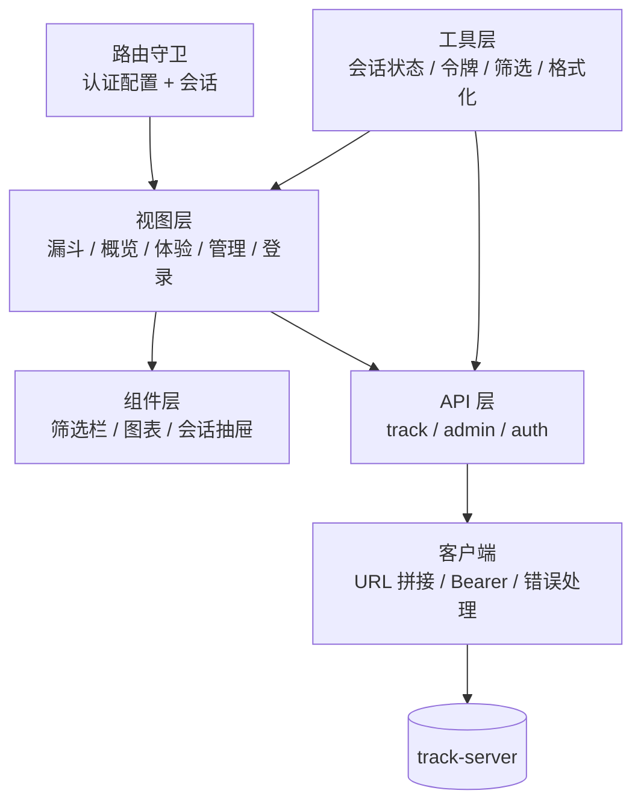

# 埋点分析看板 技术设计 V0.1

> 对应 PRD：`docs/PRD-V0.1-analytics-web.md`
> 对应源码：`packages/analytics-web/src/`（12 个 Vue 文件 + 12 个 TypeScript 文件）
> 阅读对象：看板前端维护者、埋点服务端开发、部署运维
> 文中 `src/xxx:nn` 均指本包内的相对路径与行号

## 1. 设计目标与约束

| 目标 | 落地约束 |
| --- | --- |
| 纯只读看板 | 事件数据只查不改；写操作仅存在于应用凭据与成员管理 |
| 低运维成本 | 无状态管理库、无 UI 组件二次封装、无独立鉴权体系；复用后端接口与飞书登录 |
| 接口一致性 | 前端类型定义与服务端响应结构逐字段对齐，统一在 API 客户端处理错误 |
| 可本地联调 | 开发期代理到后端，无后端时可切换到假接口服务 |
| 可维护 | 页面、组件、API、工具、样式五层分离，路由组件按需加载 |

不使用 pinia、axios、dayjs、状态管理中间件；图表只按需注册用到的图表与组件。

## 2. 总体架构

数据流方向单一：视图发起请求，API 层返回已解析数据，视图用计算属性派生展示值。会话状态与令牌由工具层单例持有，视图不直接读写本地存储。

## 3. 目录与模块索引

| 模块 | 路径 | 职责 |
| --- | --- | --- |
| 入口 | `src/main.ts`、`src/App.vue` | 注册路由与 Element Plus，容器布局与顶部导航 |
| 路由 | `src/router/index.ts` | 路由表、全局守卫、文档标题 |
| API 客户端 | `src/api/client.ts` | 基地址、查询串、令牌、错误与登录跳转 |
| API 封装 | `src/api/track.ts`、`auth.ts`、`admin.ts` | 各域接口函数 |
| 类型 | `src/api/types.ts` | 响应结构与筛选参数类型 |
| 视图 | `src/views/*.vue` | 六个页面，各自持有加载状态与筛选条件 |
| 组件 | `src/components/*.vue` | 筛选栏、图表基类、漏斗图、趋势图、会话抽屉 |
| 工具 | `src/utils/*.ts` | 会话状态、令牌、筛选默认值、枚举与格式化 |
| 样式 | `src/styles/index.css` | 颜色变量、布局卡片、进度条、响应式 |
| 假接口 | `scripts/mock-api.mjs` | 本地无后端时的完整接口替身 |
| 构建 | `vite.config.ts`、`tsconfig.json` | 端口、代理、SDK 静态映射、类型检查 |

## 4. 运行与构建配置

- 开发端口 5174，预览端口 4174，均把 `/api` 代理到 `VITE_PROXY_TARGET`（默认 `http://127.0.0.1:8080`），并开启跨域来源改写。
- `VITE_API_BASE` 留空表示同源 `/api`；生产环境由反向代理转发，前端只声明这一个运行时变量。
- 自定义 Vite 插件把 `/sdk/*` 映射到相邻包的 SDK 产物目录，JS 返回 `text/javascript` 与不缓存响应头，文件缺失时返回 404；开发服务器与预览服务器都挂载。
- 构建命令先执行 `vue-tsc --noEmit` 再做 Vite 打包；产物关闭源码映射，单块体积告警阈值 1200 KB。
- 假接口服务监听 `127.0.0.1`，默认端口 18090，启动后把开发代理指向它即可离线看页面。

## 5. 路由与导航

路由表（`src/router/index.ts`）：

| 路径 | 组件 | 元信息 |
| --- | --- | --- |
| `/` | 重定向到漏斗页 | 无 |
| `/login` | 登录视图 | 公开、无边框布局 |
| `/login/callback` | 登录回调视图 | 公开、无边框布局 |
| `/funnel` | 漏斗视图 | 标题转化漏斗 |
| `/overview` | 概览视图 | 标题事件概览 |
| `/experience` | 体验视图 | 标题体验指标 |
| `/admin` | 管理视图 | 标题管理后台 |
| 通配路径 | 重定向到漏斗页 | 无 |

全局前置守卫依次执行：读取认证配置 → 读取当前会话 → 公开路由中已登录用户访问登录页时重定向到漏斗页 → 非公开路由中未登录且服务端要求鉴权时跳转到登录页并携带回跳地址。服务端未开启鉴权时未登录用户可直接访问看板。后置守卫根据路由标题设置文档标题。

`App.vue` 对带无边框标记的路由只渲染路由视图，其余路由渲染顶栏：品牌标识、漏斗、概览、体验导航，管理员角色的用户额外看到管理后台入口；用户下拉提供退出登录。

## 6. 状态与会话

`src/utils/session.ts` 用一个响应式对象承载会话状态：当前用户、会话就绪标记、配置已加载标记、是否要求鉴权、飞书是否可用、本地登录是否可用。模块注释明确选择轻量响应式单例，不引入状态管理库。

| 函数 | 行为 |
| --- | --- |
| `ensureAuthConfig()` | 配置已加载时直接返回缓存；否则拉取认证配置，失败时静默保留默认值，最后置已加载标记 |
| `ensureSession(force)` | 会话就绪且未强制刷新时返回缓存用户；拉取当前用户失败时清空用户；最后置就绪标记 |
| `applyLogin(user, token)` | 写令牌、写用户、置就绪 |
| `signOut()` | 调用退出接口（失败也继续）、清令牌、清用户、置就绪 |
| `isAdmin()` | 判断当前用户角色是否为管理员 |

`src/utils/token.ts` 使用键 `et.auth.token` 存本地存储；模块级缓存变量区分「未读取」与「读到的空值」，存储不可用时退化为内存缓存，刷新页面后令牌丢失。

## 7. API 客户端设计

`src/api/client.ts` 的核心行为：

1. 基地址取运行时变量并去除尾斜杠；留空时请求当前同源的 `/api`。
2. 查询串拼接跳过值为 `undefined`、`null` 与空字符串的字段，用 `URLSearchParams` 编码。
3. 请求头默认带 Accept；存在令牌时带 Bearer 认证头；有请求体时补 JSON 内容类型。
4. 网络层失败抛出带零状态码的连接错误，文案提示检查后端服务。
5. 收到 401 时清除令牌并跳转登录页，携带原路径与错误消息；可关闭自动跳转用于登录态探测。
6. 非 2xx 用响应中的消息或错误码构造前端错误。
7. 响应体标记业务失败时同样转为前端错误。

接口封装：

| 文件 | 主要函数 |
| --- | --- |
| `src/api/track.ts` | 漏斗列表、漏斗结果、流失会话、会话明细、事件概览、性能、停留、完整性，全部为 GET |
| `src/api/auth.ts` | 认证配置、当前用户、飞书授权地址、本地登录、退出登录 |
| `src/api/admin.ts` | 应用列表与创建、修改、轮换、删除，成员列表与修改 |

`experienceParams()` 刻意从体验类请求中剔除钱包类型参数，只保留漏斗标识、应用、环境、国家、设备与起止时间。

## 8. 页面设计

### 8.1 漏斗视图

初始化时先拉漏斗列表，空列表显示配置提示；非空时用首个漏斗的标识、应用与环境以及最近 7 天构造查询并发起请求。派生数据包括：首步与末步会话数、整体转化率、按流失数取最大的环节，计算时排除首步。漏斗图与步骤表格共用同一份步骤数据；两者点击都进入同一个下钻处理函数，首步点击给出提示而不打开抽屉。抽屉向下传递当前筛选条件，保证下钻数据口径与当前视图一致。

### 8.2 概览视图

初始化流程与漏斗页一致。指标卡由时间点列表派生：触发量求和得到事件总量，事件名去重得到事件种类，按时间桶聚合取最大值得到峰值时间段。趋势图在触发量与独立用户之间切换；明细表按触发量降序，占比为单事件除以总量。页面显式提示独立用户为各时间桶求和而非全区间去重，并展示服务端返回的时间偏移。

### 8.3 体验视图

加载时并发请求性能、停留、完整性三个接口。性能部分定义六项指标元数据，区分毫秒与无量纲分数的格式化方式；指标表展示样本数与五项统计值，另有按页面、国家、设备分组的最大内容绘制分位表。停留部分展示样本数、平均值与分位数，另有按页面与结束原因的分组表。完整性部分对比声明与实际条数，缺失大于零时显示告警并列出不一致批次。

### 8.4 管理视图

页面加载时并发获取应用列表与签名配置。顶部展示上报路径、环境、签名要求与时间窗。应用表格列包含名称、掩码密钥、环境、状态、来源与创建信息，操作列提供复制标识、轮换密钥、启停与删除；来源为环境变量的行只显示只读提示。创建表单限定名称与备注长度，并在同环境下做大小写不敏感的重名校验。成员标签只对管理员可见，角色与状态控件对自己的行禁用，角色变更后强制刷新当前会话。

凭据弹窗展示应用标识、明文密钥、环境与接入代码，并提供凭据备份内容。接入代码生成逻辑见第 10 节。

### 8.5 登录与回调视图

登录页默认二维码标签；二维码地址来自服务端接口，嵌在iframe中并带不引用来源策略，提供刷新与新窗口打开两种兜底。授权跳转模式直接整页跳转到服务端返回的地址。本地调试模式提交用户名后写令牌并刷新会话。

回调视图从 URL 片段读取令牌（不经服务端日志与来源头），写入后回服务端换取用户信息；成功后替换路由到漏斗页以清除地址栏凭证。登录视图同时监听页面消息，只接受约定类型的消息，拿到令牌后同样回服务端校验，不信任消息来源。

## 9. 组件设计

| 组件 | 设计要点 |
| --- | --- |
| 筛选栏 | 受控组件，通过统一更新函数合并补丁并向外发查询事件；漏斗下拉联动应用与环境；国家输入转大写；时间范围用日期时间区间选择器并提供四个快捷项；重置恢复首个漏斗与默认 7 天 |
| 会话抽屉 | 每页 20 条分页加载，会话列表显示缩短后的标识与时间；点击会话打开二级抽屉，用时间线展示事件序列，按事件类型着色，展示钱包类型、失败原因、订单号、用户标识与格式化后的属性 |
| 图表基类 | 按需注册画布渲染、柱状、漏斗、折线与相关组件；初始化后设置配置并绑定点击事件透传数据序号；用尺寸观察器自动重绘；卸载时释放实例 |
| 漏斗图 | 保留服务端给定顺序不排序；标签两行显示步骤与转化；点击色块向上抛出步骤事件 |
| 趋势图 | 时间桶去重排序，事件按触发量降序；桶数超过 24 时启用内外两种缩放；折线平滑且不显示单点符号 |

## 10. 接入代码生成

管理后台的脚本标签片段按以下规则拼装（`src/views/AdminView.vue`）：

- 上报基址取服务端返回的对外域名，为空则用当前站点来源，并去除尾部斜杠。
- 默认上报地址等于上报基址加服务端返回的上报路径，路径缺省为约定的埋点接口。
- SDK 文件地址取服务端返回的 SDK 地址，缺省为上报基址下的固定 SDK 路径。
- 片段先用防重复脚本检查，再初始化全局队列并压入只包含应用标识的初始化指令，随后异步插入带约定标识与脚本地址的 script 元素。
- 拼接标签字符串时把标签名拆开，避免被模板解析器当作真实标签。
- 复制操作用浏览器剪贴板接口，失败时提示手动选择复制。

设计取舍：片段不带环境、密钥与上报地址，依赖 SDK 按自身脚本域推导上报地址、服务端按应用记录判定环境；因此静态资源域与采集域不同的部署必须显式配置 SDK 地址或使用带签名的构造函数形态。

## 11. 时间与格式化

筛选条件中的起止时间由本地日期对象经标准 UTC 字符串转换后传给后端；前端不向任何接口传时区偏移。服务端返回的时偏只在概览页展示。展示层统一使用中文地区与 24 小时制，指标卡与表格使用千分位格式化，比例按大小保留一到两位小数，长标识按指定保留长度截断并加省略号，事件名映射到中文标签，未登记事件显示为未知事件。

## 12. 假接口服务

`scripts/mock-api.mjs` 用原生 HTTP 模块实现，提供看板用到的全部接口：漏斗元数据、漏斗结果、流失会话、会话明细、事件概览、性能、停留、完整性、认证与成员管理。跨来源请求统一放行，预检请求返回成功状态。

固定样本包括五个漏斗步骤与对应会话数、六个事件名、一个环境变量来源应用与一个后台创建应用、一个管理员用户与签名配置。漏斗配置中的标识与应用名与后端样例保持一致。飞书授权地址接口返回未启用错误，便于验证登录页的未配置提示。未匹配的请求返回统一的未找到错误。

## 13. 异常与降级

| 异常 | 处理位置 | 行为 |
| --- | --- | --- |
| 连接失败 | API 客户端 | 抛出连接错误并由页面提示检查后端服务 |
| 401 | API 客户端 | 清令牌、跳登录页、携带回跳参数 |
| 业务失败标记 | API 客户端 | 转为前端错误并显示 |
| 漏斗为空 | 漏斗与概览视图 | 显示配置提示，停止后续查询 |
| 令牌校验失败 | 登录与回调视图 | 清令牌并显示凭证失效 |
| 剪贴板拒绝 | 管理视图 | 提示手动复制 |
| 非管理员访问 | 管理视图 | 显示权限不足空态 |
| 存储不可用 | 令牌工具 | 退化为内存缓存 |
| 容器尺寸变化 | 图表基类 | 观察尺寸并重绘 |

## 14. 构建与验证

| 命令 | 作用 |
| --- | --- |
| `npm run dev` | 启动开发服务器，端口 5174 |
| `npm run mock` | 启动假接口服务，端口 18090 |
| `VITE_PROXY_TARGET=http://127.0.0.1:18090 npm run dev` | 用假接口驱动看板 |
| `npm run typecheck` | 静态类型校验 |
| `npm run build` | 类型校验后打包 |
| `npm run preview` | 预览构建产物，端口 4174 |

当前没有前端自动化测试文件；验证手段为类型检查、构建通过、开发服务器代理链路与人工交互回归。

## 15. 已知限制与技术债

| 项 | 说明 | 影响 |
| --- | --- | --- |
| 无自动化测试 | 仅有静态类型校验与构建验证 | 交互回归依赖人工 |
| 时区显示差异 | 前端不传时区偏移，用浏览器本地时区展示 | 与服务端默认时区不同时显示时间不一致 |
| 独立用户口径 | 各时间桶去重后求和 | 与全区间去重的结果不同 |
| 令牌存储 | 保存在本地存储而非只读cookie | 跨站脚本可窃取；当前不加载第三方脚本 |
| 罗马数字与百分位 | 分位数由服务端计算，前端只展示 | 口径变更需服务端同步 |
| 生产代理未入库 | 反向代理配置不在本仓库 | 部署时需另行配置接口与 SDK 路径 |
| 图表高度固定 | 漏斗与趋势图使用固定高度像素值 | 极小屏下需滚动查看 |

## 16. 关键参数速查

开发端口 `5174` ｜ 预览端口 `4174` ｜ 后端代理默认 `8080` ｜ 假接口端口 `18090` ｜ 默认时间窗 `7` 天 ｜ 快捷区间 `24h/7d/30d/90d` ｜ 默认环境 `prod` ｜ 会话抽屉每页 `20` 条 ｜ 趋势缩放阈值 `24` 个时间桶 ｜ 进度条最小宽度 `2%` ｜ 图表高度 `340/360px` ｜ 内容区最大宽度 `1440px` ｜ 令牌键 `et.auth.token` ｜ 构建告警阈值 `1200 KB` ｜ 环境选项 `5` 个 ｜ 国家选项 `50` 个 ｜ 事件中文标签 `6` 项 ｜ 性能指标 `6` 项 ｜ 漏斗步骤 `5` 步
