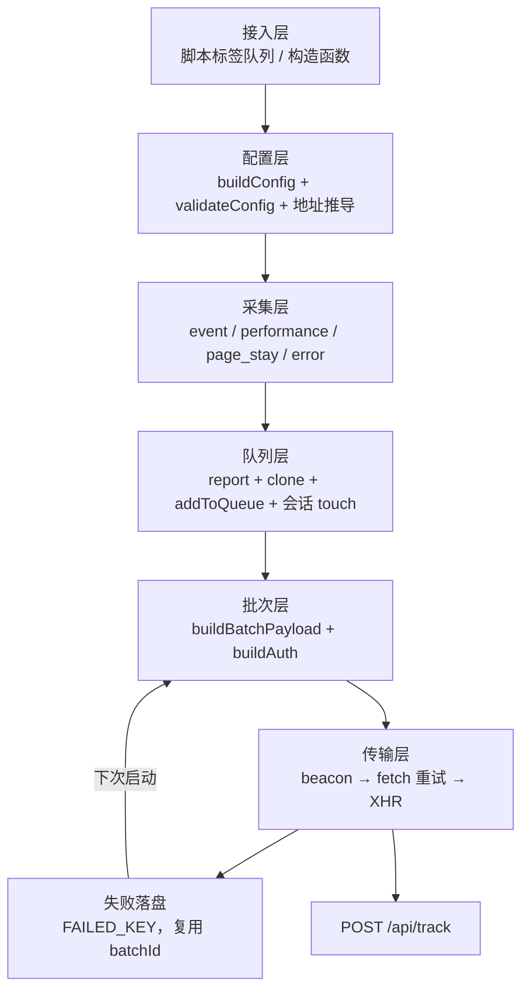

# track-sdk 技术设计 V2.3

> 对应 PRD：`docs/PRD-V2.3-track-sdk.md`
> 对应源码：`packages/sdk-web/track-sdk.js`（v2.3.0，1672 行）
> 阅读对象：SDK 维护者、接入方前端开发、埋点服务端开发
> 文中 `track-sdk.js:xxxx` 均指该文件行号

## 1. 设计目标与约束

| 目标 | 落地约束 |
| --- | --- |
| 单文件可嵌入 | 一个 UMD 文件，零运行时 npm 依赖；内联同步 HMAC 实现，不依赖 Web Crypto 的异步接口 |
| 接入成本最低 | 脚本标签形态只需 appId；服务地址按脚本所在域推导；环境由服务端按 appId 判定 |
| 数据可信 | 指标两阶段上报、入队快照、批次幂等标识、4xx 短路、失败补发复用批次标识 |
| 不影响宿主 | 捕获阶段事件委托、监听全量可移除、路由包装可还原、多实例告警与复用 |
| 可回归 | `node:test` 42 个用例，覆盖源码与压缩产物两套入口 |

明确不引入：构建框架的运行时 polyfill、服务端依赖、队列中间件、加密密钥管理。

## 2. 总体架构



分层原则：采集层只负责产生记录，不感知传输；队列层只负责缓冲与快照，不感知协议；批次层统一收敛公共字段与签名；传输层负责通道选择与失败语义。

## 3. 源码模块索引

| 模块 | 行号范围 | 职责 |
| --- | --- | --- |
| UMD 包装与常量 | `track-sdk.js:7-71` | 导出适配、版本号、存储键、默认配置 |
| 工具函数 | `track-sdk.js:79-311` | 配置读取、ID 生成、节流、history 包装、深拷贝 |
| 内联哈希 | `track-sdk.js:159-296` | SHA-256 压缩函数与 HMAC 实现 |
| 地址推导 | `track-sdk.js:319-337` | 从脚本标签 src 推导 `/api/track` |
| 配置构建与校验 | `track-sdk.js:339-394` | 类型读取、越界校验、缺省回落 |
| 构造器与采样 | `track-sdk.js:402-463` | 实例初始化、会话加载、采样与总开关短路 |
| 性能采集 | `track-sdk.js:519-771` | observer 封装、导航计时、load/final 两阶段指标 |
| 页面停留与路由 | `track-sdk.js:776-886` | 分段计时、路由 hook 与还原 |
| 点击追踪 | `track-sdk.js:890-950` | 事件委托、向上查找、元素路径 |
| 错误监控 | `track-sdk.js:954-1028` | 三类错误归一化、去重与限流 |
| 事件上报入口 | `track-sdk.js:1032-1101` | `track` / `report` / 入队与调度 |
| 批次构造与签名 | `track-sdk.js:1105-1218` | payload、auth、请求头与 beacon query |
| 传输通道 | `track-sdk.js:1221-1340` | beacon / fetch / XHR / 落盘 |
| 本地存储 | `track-sdk.js:1342-1458` | 会话、退出状态、失败批次读写 |
| URL 脱敏与配置更新 | `track-sdk.js:1470-1531` | 参数打码、配置合并与监听重建 |
| 销毁与静态 API | `track-sdk.js:1537-1572` | 监听移除、observer 断开、history 还原 |
| 脚本标签 bootstrap | `track-sdk.js:1582-1668` | 队列回放、data-* 解析、自动初始化 |

## 4. 关键常量与默认配置

### 4.1 常量

| 常量 | 值 | 用途 |
| --- | --- | --- |
| `SDK_VERSION` | `2.3.0` | 实例版本、批次字段与静态属性 |
| `SESSION_TIMEOUT` | `1800000` ms | 会话无操作过期阈值 |
| `SESSION_TOUCH_INTERVAL` | `5000` ms | 会话活跃时间刷新节流 |
| `ERROR_DEDUPE_WINDOW` | `5000` ms | 相同错误去重窗口 |
| `MAX_ERROR_REPORTS` | `50` | 单页错误上报上限 |
| `MAX_FAILED_BATCHES` | `5` | 本地失败批次保留上限 |
| `MAX_BEACON_BYTES` | `61440` | beacon 载荷上限，超出降级 fetch |
| `MAX_RESOURCE_ITEMS` / `MAX_LONG_TASK_ITEMS` | `20` | 明细采集与上报上限基数 |
| `MAX_PATH_CLASSES` | `3` | 点击元素路径保留类名数 |
| `MAX_BACKOFF` | `30000` ms | 重试退避上限 |
| `GLOBAL_QUEUE_KEY` / `SCRIPT_ID` | `__trackQueue` / `track-sdk` | 脚本标签接入约定 |
| `DEFAULT_ENDPOINT_PATH` | `/api/track` | 服务地址推导路径 |

本地存储键统一前缀 `__track_sdk_`：`__track_sdk_session__`、`__track_sdk_opt_out__`、`__track_sdk_failed__`、`__track_sdk_probe__`（最后一个用于探测存储可用性）。

### 4.2 默认配置

| 字段 | 默认值 | 字段 | 默认值 |
| --- | --- | --- | --- |
| `serverUrl` | 占位地址（浏览器优先推导） | `autoTrack` | `true` |
| `appId` | `''` | `debug` | `false` |
| `userId` | `''` | `batchSize` | `10` |
| `batchTimeout` | `5000` | `maxRetries` | `3` |
| `retryDelay` | `1000` | `enableErrorTracking` | `true` |
| `enableResourceTracking` | `false` | `enableClickTracking` | `true` |
| `sampleRate` | `1` | `enabled` | `true` |
| `urlSanitize` | `true` | `persistFailed` | `true` |
| `maxQueueSize` | `200` | `contentType` | `text/plain;charset=UTF-8` |
| `env` | `''` | `signSecret` | `''` |

配置读取设计：`readNumber` / `readBoolean` / `readString` 只在值为 `undefined` 或 `null` 时回落默认值，因此 `0` 不会被 `||` 吞掉（`track-sdk.js:79-103`）。类型不符直接抛错，避免 `NaN` 通过范围校验后造成静默不上报。

校验规则（`track-sdk.js:369-394`）：`sampleRate` 必须在 `[0,1]`；`batchSize` 与 `maxQueueSize` 至少为 1；`batchTimeout`、`retryDelay`、`maxRetries` 不可为负；缺少 appId 仅告警不阻断。`updateConfig` 复用同一校验函数，失败时保留原配置对象。

## 5. 核心数据结构

### 5.1 记录

```js
{ type: 'event' | 'performance' | 'page_stay' | 'error',
  timestamp: Date.now(),
  data: { /* 入队时已做快照 */ } }
```

### 5.2 批次载荷

```js
{
  appId, sdkVersion, userId, sessionId, batchId, sentAt,
  env, // 为空时不输出
  context: { url, referrer, title, userAgent, language,
             screen: {width, height}, viewport: {width, height}, devicePixelRatio },
  batch: [/* records */]
}
```

公共字段收敛到批次层，避免逐条重复携带 UA 与视口信息，降低原始字节数。载荷构造见 `track-sdk.js:1105-1128`。

### 5.3 失败批次

```js
{ ts: Date.now(), batchId, records: [/* 原始记录数组 */] }
```

只存记录与批次标识，不存已序列化字符串、认证信息或上下文；补发时重新构造载荷并复用批次标识。

### 5.4 会话状态

```js
{ id: 'sess_<ms>_<base36(9)>', lastActive: <ms> }
```

### 5.5 认证信息

```js
{ appId, sentAt, sign } // sign 为空字符串表示不签名
```

## 6. 初始化与接入链路

### 6.1 构造流程

`new TrackerSDK(options)` 顺序（`track-sdk.js:402-463`）：

1. `buildConfig` → `validateConfig` → 赋值。
2. 加载会话标识。
3. 计算 `this.sampled = Math.random() < sampleRate`。
4. 多实例告警：模块级 `activeInstance` 已存在且未销毁时输出告警。
5. `init()`：总开关或采样未命中直接返回；否则注册性能、停留、错误、点击、路由监听。
6. `resumeFailedBatches()`：初始化成功末尾执行，补发历史失败批次。

### 6.2 服务地址推导

`resolveDefaultServerUrl()`（`track-sdk.js:319-337`）取 `document.currentScript` 或 `id="track-sdk"` 的脚本元素，用 `new URL('/api/track', src).href` 推导，结果缓存在模块变量中。显式传入的 `serverUrl` 优先级最高；其次解析其 query 中的 `appId` 与 `env`。这一设计使脚本标签只需 appId，但代价是静态资源域与采集域不同时必须显式配置。

### 6.3 脚本标签 bootstrap 状态机

`bootstrapFromPage()`（`track-sdk.js:1621-1666`）在模块加载末尾自动执行：

1. 队列已有 `.instance` → 直接返回，防止重复脚本重复注册。
2. 扫描 `__trackQueue`，找到 `init` 指令作为初始化参数，其余进入待回放队列。
3. 没有 `init` 时，从 `currentScript` 或 `id="track-sdk"` 读取 `data-server-url`、`data-app-id`、`data-env`。
4. 仍无有效配置 → 返回 `null`，SDK 不自动初始化。
5. 构造实例后按序回放 `track` / `trackEvent` / `flush`；单条指令异常只告警，不中断后续回放。
6. 把原队列替换为转发器：`push` 即时转发到实例，`init` 走 `updateConfig`，并挂 `.instance` 供外部取用。

### 6.4 多实例策略

模块级 `activeInstance` 保存当前实例；重复构造时告警但不阻止。`TrackerSDK.getInstance(options)` 在实例未销毁时直接复用，避免单页应用多次初始化造成链式 history 包装与重复上报。

## 7. 采集子系统

### 7.1 统一入口

`report(type, data)`（`track-sdk.js:1056-1078`）是所有采集的唯一入口，依次检查销毁态、浏览器环境、`enabled`、`optedOut` 与 `sampled`，任一不通过返回 `false`。通过时用 `clone()` 做快照：`JSON.parse(JSON.stringify(data))`，失败时降级为数组 `slice` 或对象浅拷贝。记录入队后调用 `touchSession()`。

### 7.2 性能指标

全部通过 `createObserver()` 封装 `PerformanceObserver`，并开启 `buffered: true` 以采集 SDK 加载前的条目。

| 指标 | observer 类型 | 计算方式 |
| --- | --- | --- |
| FCP | `paint` | `first-contentful-paint` 的 `startTime` |
| LCP | `largest-contentful-paint` | 取最后一条 entry；首次输入后断开 observer |
| FID | `first-input` | `processingStart - startTime`，仅作兼容 |
| CLS | `layout-shift` | 跳过 `hadRecentInput`；最大 session window，精度 `1e-4` |
| INP | `event`，`durationThreshold: 40` | 按 `interactionId` 分组取最大 duration，再取 p98 |
| 长任务 | `longtask` | `{duration, startTime}`，采集上限 100 条 |
| 资源 | `resource` | 只采 `duration > 100ms`，采集上限 100 条 |

CLS 的 session window 算法：相邻条目间隔超过 1 秒或当前窗口持续超过 5 秒则清零重开，取所有窗口中的最大累计值（`track-sdk.js:659-678`）。INP 的 p98 索引为 `ceil(n * 0.98) - 1` 并夹在 `[0, n-1]`（`track-sdk.js:722-735`）。

两阶段上报：

- `load` 阶段：window load 或文档已 complete 时执行，采集 `PerformanceNavigationTiming` 的 DNS、TCP、TTFB、响应、DOM 解析、DOM Ready、Load 等指标（含旧 `performance.timing` 回退与负值归零）与 FCP。
- `final` 阶段：visibilitychange 隐藏、pagehide、beforeunload 或 `destroy()` 触发，带 `finalReported` 幂等守卫；上报最终 Web Vitals、长任务与资源明细，随后断开五个 observer。

设计取舍：牺牲中间态实时性，换取最终指标定型后再入库，避免数仓里堆积无意义的中间值。

### 7.3 页面停留与路由

`pageTracker` 保存起点、累计时长、页面链接与可见性。`accumulateStayTime()` 只在可见时结算，并立即把 `isVisible` 置为 false，配合 `pageEndHandled` 标志防止卸载与隐藏事件重复计数。分段时长不足 1000ms 直接丢弃。

路由变化通过包装 `pushState` / `replaceState` 与监听 `popstate` 感知：先执行原生跳转，再调用 `handleUrlChange()`；该函数确认链接确实变化后结算上一页并重置计时。`restoreHistory()` 只在当前方法仍是本 SDK 的包装函数时还原，避免误还原其他库后续覆盖。

### 7.4 点击追踪

document 上以捕获阶段注册 click 监听，不做节流——埋点需要全量采集，节流会吞掉高频点击。`findTrackElement()` 沿父节点向上查找带 `data-track` 的元素，支持点击 SVG 图标或 span 子节点。`getElementPath()` 通过 `getAttribute('class')` 读取类名以规避 SVG 元素的 `className` 对象问题，最多保留 3 个类名，文本截断 100 字符。

### 7.5 错误监控

三类监听：全局 `error` 冒泡阶段处理 JS 异常，`unhandledrejection` 处理未处理拒绝（兼容字符串等原始值），全局 `error` 捕获阶段处理资源加载失败。去重键为类型、消息、文件名与行号拼接；5 秒窗口内重复或单页累计达到 50 条时丢弃并累计丢弃计数。堆栈截断 2000 字符，链接先脱敏。

## 8. 队列与快照

`addToQueue()`（`track-sdk.js:1080-1092`）：队列长度达到 200 时 `shift()` 丢弃最旧记录并累计计数；达到 10 条立即 `flushQueue()`，否则设置 5 秒定时且已有定时器时不重复设置。快照在入队前完成，因此 observer 后续更新不会污染已入队记录——这是从「共享引用」缺陷修正而来的关键设计。

## 9. 上报子系统

### 9.1 发送编排

`sendData(records, opts)`（`track-sdk.js:1147-1179`）先确定批次标识（`opts.batchId` 或新生成），只构造一次 payload 字符串与认证信息，再按序尝试三个通道。共享同一份字符串与签名，避免各通道各自生成批次标识导致服务端幂等失效。

### 9.2 sendBeacon

触发条件：`opts.beacon === true` 或页面处于隐藏状态。载荷超过 60 KB 时不拆分（字符串二分无法保证 JSON 完整），直接降级 fetch。使用 `Blob([payload], { type: contentType })`；`contentType` 默认 `text/plain;charset=UTF-8` 属简单请求，避免跨域预检在卸载期造成静默丢数。只有浏览器返回 `accepted === true` 才视为成功。

### 9.3 fetch 与重试

`POST` + 请求头 + `keepalive: true` + `credentials: 'omit'`。2xx 成功；4xx 返回丢弃状态；其余状态或网络错误进入重试。

请求次数为 `maxRetries + 1`，即默认 4 次。退避公式：

```
base  = retryDelay × 2^attempt
jitter = 0.5 + Math.random() × 0.5        // [0.5, 1)
delay = min(round(base × jitter), 30000)  // ms
```

抖动用于打散大量客户端同时失败的重试尖峰；最后一次失败不再等待。

### 9.4 XHR 降级

fetch 全部失败后使用 `XMLHttpRequest` 异步 POST。2xx 成功，4xx 直接按成功返回（永久性失败语义），网络错误返回失败。XHR 不额外重试。

### 9.5 4xx 短路语义

这是与旧版最重要的行为差异：SDK 把 4xx 解释为「服务端明确拒绝且重试无意义」，因此不重试、不降级、不落盘。否则未授权、格式非法、body 超限等永久失败会形成跨会话反复补发的死循环。5xx 与网络错误才被视为可恢复失败。

### 9.6 失败持久化与补发

三通道全败且 `persistFailed=true` 时写 `__track_sdk_failed__`，结构为 `{ts, batchId, records}`，最多 5 批并丢弃最旧。启动时先 `removeItem` 再逐批 `sendData(records, {batchId})`，补发失败会按原批次标识重新落盘。批次标识冻结直接解决「服务端已入库但响应丢失」场景下的重复写入问题。

### 9.7 请求签名

内联同步 HMAC-SHA256（`track-sdk.js:159-296`），选择同步实现的原因是 sendBeacon 路径无法等待异步的 Web Crypto 接口。签名原文：

```
HMAC_SHA256(signSecret, appId + "." + sentAt + "." + rawBody)
```

`rawBody` 为最终的 payload 字符串，`sentAt` 取认证信息独立时间戳，与 body 内的 `sentAt` 分别取值。fetch 与 XHR 通过 `X-Track-App-Id` / `X-Track-Sent-At` / `X-Track-Sign` 请求头传递；beacon 无法设置自定义头，降级为 URL query 参数 `appId` / `sentAt` / `sign`。未配置密钥时不产生签名头，配合服务端 `SIGN_REQUIRED=false` 的脚本标签形态。

## 10. 会话、采样与隐私

会话标识在构造时从 `__track_sdk_session__` 加载：距最后活跃不足 30 分钟复用，否则新建。每次入队调用 `touchSession()`，按 5 秒节流；超过 30 分钟更换标识。加载与刷新对边界时刻的判定方向不同（前者用严格小于，后者用严格大于），属于已知细微差异。

采样在实例创建时判定一次，并在 `report()` 中再次判定，保证手动事件与自动事件受同一控制；`enabled: false` 与 `optedOut` 同样在入口短路且不注册监听。更新采样率会重新掷骰。

URL 脱敏（`track-sdk.js:1470-1497`）先移除 `#` 及后续内容，再逐段解析 query，对命中敏感名单的参数值替换为 `***` 并保留参数名。名单覆盖令牌、授权、密码、密钥、签名、会话、手机号、邮箱、证件号与票券类字段。退出采集状态写入 `__track_sdk_opt_out__`，开启时立即清空队列并取消定时器。

## 11. 生命周期与销毁

`destroy()`（`track-sdk.js:1552-1564`）幂等执行：上报最终指标 → 按页面可见性选择通道发送剩余队列 → `teardownTracking()` → 标记销毁态。`teardownTracking()` 包含四步：`offAll()` 移除所有通过统一注册函数登记的监听、`disconnectAllObservers()` 断开全部 observer、`restoreHistory()` 还原路由包装、清除批量定时器。若当前实例是 `activeInstance` 则一并置空。

`updateConfig()` 中功能开关类字段变化时复用同一套拆除与重建流程，确保不会出现重复监听或 observer 泄漏。

## 12. 服务端契约

| 项 | SDK 侧约定 | 服务端必须配合 |
| --- | --- | --- |
| 请求 | `POST /api/track`，批次 JSON | 按原始请求体解析，不依赖 Content-Type |
| 简单请求 | `text/plain;charset=UTF-8` | 返回 `Access-Control-Allow-Origin` 与允许 `POST` |
| 幂等 | 每批一个 `batchId`，补发复用 | 以 `batchId` 建幂等键，重复批次返回 200 |
| 返回码 | 4xx 短路；5xx 重试与补发 | 永久失败返回 200，可恢复失败返回 503 |
| 环境 | `env` 为空时不输出 | 按 appId 查应用记录判定环境 |
| 签名 | 可选，头部或 query 传递 | 按同一原文验签；脚本标签形态设 `SIGN_REQUIRED=false` |

## 13. 异常与降级矩阵

| 异常 | 检测点 | 降级行为 |
| --- | --- | --- |
| 配置类型或范围非法 | `validateConfig` | 抛错；更新配置时保留原值 |
| 浏览器 API 缺失 | observer / beacon / storage 探测 | 跳过对应能力，不中断其他采集 |
| 本地存储不可用 | 探针键写入测试 | 禁用会话持久化与失败落盘 |
| 队列溢出 | `addToQueue` | 丢弃最旧，累计丢弃计数 |
| beacon 载荷过大 | 字符串长度检查 | 降级 fetch |
| 4xx | fetch / XHR 状态判断 | 终止本次发送，不重试不落盘 |
| 5xx / 网络错误 | fetch 抛错或状态码 | 重试 → XHR → 落盘 |
| 补发再次失败 | `resumeFailedBatches` | 按原批次标识写回本地存储 |
| 重复脚本加载 | 队列 `.instance` 检测 | 直接返回，复用既有实例 |
| 路由方法被覆盖 | 函数引用比对 | 只还原自身的包装函数 |

## 14. 测试设计

测试使用 Node 内置 `node:test`，通过 `test/dom-mock.js` 模拟 window、document、fetch、beacon 与 localStorage，不依赖浏览器环境。

| 测试文件 | 用例数 | 覆盖范围 |
| --- | --- | --- |
| `test/tracker.test.js` | 36 | 采样与配置校验、零值处理、debug 仍上报、立即发送、结构一致性、入队快照、URL 脱敏、退出采集、点击子元素与 SVG、销毁清理、多实例、停留计时、SPA 路由、导航指标、CLS 算法、INP、错误去重、beacon 内容类型、退避与补发、XHR 降级、会话持久化、配置更新、地址推导、队列回放、UMD 导出 |
| `test/signature.test.js` | 10 | 内联 HMAC 与 Node crypto 一致、中文签名、请求头签名、无密钥无签名头、beacon query 签名、4xx 短路、5xx 重试与批次标识、补发幂等、环境字段 |

构建后可用 `SDK_ENTRY=dist/track-sdk.min.js npm test` 对压缩产物跑同一套用例，验证压缩未改变行为。

## 15. 构建与发布

| 命令 | 作用 |
| --- | --- |
| `npm run lint` | ESLint 检查源码与测试 |
| `npm test` | 运行 42 个用例 |
| `npm run build` | 生成 `dist/track-sdk.min.js`，二次压缩与混淆，保留以 `!` 开头的注释 |
| `npm run prepublishOnly` | 发布前依次执行检查、测试与构建 |

产物通过 `unpkg` 与 `jsdelivr` 字段暴露；`files` 字段只分发源码、压缩产物与说明文档。SDK 静态文件在开发环境由看板的 Vite 中间件映射到 `/sdk/*`，生产环境由 Web 服务器提供。

## 16. 已知限制与技术债

| 项 | 说明 | 影响 |
| --- | --- | --- |
| 最终指标依赖页面隐藏 | 长期不隐藏的标签页没有最终阶段数据 | 仅保留 load 阶段指标 |
| 会话边界判定差异 | 加载用严格小于、刷新用严格大于判断 30 分钟 | 边界时刻可能出现一次会话标识差异 |
| `sendBeacon` 成功语义 | 返回 true 只表示浏览器已入队 | 无法确认服务端入库 |
| fetch 无超时控制 | 仅重试次数与退避上限，未设置请求超时 | 极端网络下可能长时间挂起 |
| 密钥前端可见 | 构造函数形态的密钥随脚本下发 | 只能提高伪造门槛，不能防逆向 |
| 单文件规模 | 源码 1672 行集中在单文件 | 修改需依赖测试覆盖，拆包会破坏零依赖嵌入 |

## 17. 关键参数速查

`2.3.0` ｜ 批量 `10` 条 / `5000ms` ｜ 重试 `3` 次（共 4 次请求）｜ 退避 `1000ms × 2^attempt × [0.5,1)`，上限 `30000ms` ｜ 队列 `200` 条 ｜ beacon 上限 `60KB` ｜ 会话 `30min` / touch `5s` ｜ 错误去重 `5s` / 上限 `50` 条 ｜ 失败批次上限 `5` ｜ CLS 窗 `1s/5s`，精度 `1e-4` ｜ INP p98 / `40ms` 阈值 ｜ 资源 `>100ms` ｜ 明细上限 `20` 条 ｜ 停留 `<1000ms` 不报 ｜ 元素路径类名上限 `3` ｜ 堆栈截断 `2000` 字符 ｜ 本地存储前缀 `__track_sdk_`
