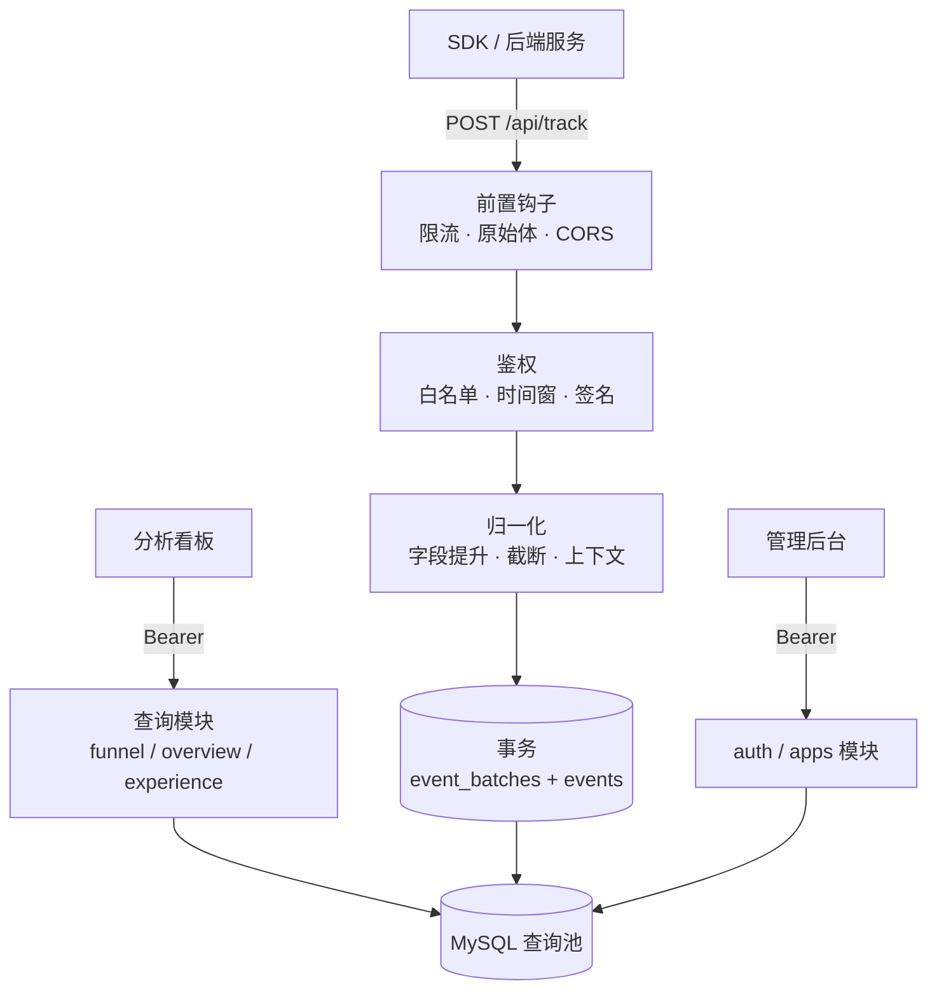

# 埋点接收与查询服务 技术设计 V0.1

> 对应 PRD：`docs/PRD-V0.1-track-server.md`
> 对应源码：`packages/track-server/src/`（46 个 TypeScript 文件）
> 阅读对象：服务端维护者、埋点 SDK 维护者、数据库与部署运维
> 文中 `src/xxx:nn` 均指本包内的相对路径与行号

## 1. 设计目标与约束

| 目标 | 落地约束 |
| --- | --- |
| 写链路稳定 | 上报接口与查询接口使用独立数据库连接池，可拆分为两个进程；慢聚合不得挤占写入连接 |
| 数据不丢不重 | 幂等表与事件表同事务；批次标识冻结；永久失败返回成功状态；可恢复失败返回可重试状态 |
| 查询口径可复现 | 漏斗按会话去重与窗口约束；分位数用确定性行号算法；时间统一 UTC 存储 |
| 运维成本低 | 无消息中间件与缓存中间件；单库两张业务表加四张管理表；结构化日志 |
| 可测 | 依赖注入与内存假库，`app.inject()` 驱动全链路测试，不依赖真实数据库 |

技术选型：TypeScript + NodeNext ESM、Fastify 5、MySQL2、zod、yaml、pino、ua-parser-js；测试用 vitest。

## 2. 总体架构

写入路径与查询路径在进程启动时按 `START_MODE` 选择性注册，`mode !== 'api'` 注册上报，`mode !== 'ingest'` 注册鉴权钩子与全部查询及管理路由。

## 3. 启动与装配

`src/main.ts` 启动顺序：加载配置 → 加载并校验漏斗配置 → 创建数据库连接池 → 构建 Fastify 应用 → 注册优雅退出钩子 → 监听端口。启动日志打印进程模式、端口与漏斗键；失败时关闭连接池并以非零状态退出。

`src/config/index.ts` 用 zod 在启动时校验全部环境变量，缺配置直接失败。关键分组：

| 分组 | 变量与默认值 |
| --- | --- |
| 进程 | 环境=development、启动模式=all、主机=0.0.0.0、端口=8080 |
| 数据库 | 地址、端口、账号、库名、写入池=10、查询池=5、查询超时=5000 毫秒 |
| 鉴权 | 应用密钥映射、是否要求签名=true、签名窗口=300 秒 |
| 限流 | 单 IP=600/分钟、单应用=3000/分钟、跨域来源=通配 |
| 协议上限 | 报文=262144 字节、单批=50 条、单条属性=16384 字节 |
| 业务 | 默认环境=prod、默认时偏=+08:00、漏斗配置路径可选 |
| 地址 | 对外上报基址、SDK 文件地址（供看板生成接入代码） |
| 登录 | 飞书应用凭证与接口地址、看板地址、会话有效期=168 小时、管理员白名单、是否强制登录、调试登录开关 |
| 网关头 | 客户端 IP 头、国家头、地区头，各自按顺序取首个命中 |

派生规则：是否强制登录默认等于是否生产环境；调试登录只在非生产且未显式关闭时开启；飞书启用条件是应用标识与密钥都非空；只写入模式且应用密钥为空时启动失败。

`src/app.ts` 注册顺序：原始报文插件 → 跨域插件 → 错误处理插件 → 两个固定窗口限流器 → 健康检查与就绪检查 → 按模式注册业务路由。就绪检查执行简单查询，失败返回 503。未匹配路由统一返回 404。

## 4. 上报链路

### 4.1 处理顺序

`src/modules/ingest/ingest.route.ts` 的处理步骤：

1. 取原始报文、请求头与客户端 IP。
2. IP 限流，超限返回 429 并带重试等待秒数。
3. 空报文返回成功状态并标记原因为空报文。
4. 验签；失败时写拒绝日志并返回成功状态与原因。
5. 按应用标识解析默认环境。
6. 应用限流，超限返回 429。
7. 解析 IP、国家、地区与用户代理。
8. 执行批次入库；重复批次返回重复标记，跳过记录超过零时输出告警日志。
9. 捕获拒绝类错误转成功状态，其他异常交给错误处理插件转 503。

### 4.2 验签

`src/modules/ingest/auth.ts`：应用标识优先取请求头再取查询参数；查不到应用返回未知应用；关闭签名校验时只做白名单；时间戳缺失或非数字分别返回对应原因；超出时间窗返回过期；摘要不匹配返回签名非法。`src/lib/signature.ts` 使用恒定时间比较，提供的摘要先转小写，长度不等直接判失败。

拒绝原因全集：缺少应用标识、未知应用、缺少签名、时间戳非法、请求过期、签名非法、非法 JSON、载荷非法、应用标识不一致、批次过大、全部记录非法、空报文、报文过大、媒体类型不支持。

### 4.3 校验与归一化

`src/modules/ingest/payload.schema.ts` 用 zod 校验信封：应用标识、版本、用户标识、会话标识、批次标识、时间戳、环境、上下文；批次字段刻意只校验为非空数组而不逐条校验，避免一条脏数据毁掉整批。

`src/modules/ingest/normalizer.ts` 的处理：

- 字符串先裁剪，空值转空；超过列宽的字段截断。
- 订单号、钱包类型、失败原因从属性中按驼峰或下划线两种命名提取。
- 业务事件要求事件名非空；其他记录类型把整个数据对象作为属性，事件名为空值。
- 属性序列化失败或超出单条上限时跳过该条。
- 客户端事件时间与接收时间偏差超过 24 小时时回退使用服务端时间。
- 国家码截两位、设备类型截 16 字符、页面路径截 255 字符并去除查询串。

### 4.4 事务与返回码

`src/modules/ingest/ingest.service.ts` 在独立写入池上开启事务，先插入批次表，主键冲突则回滚并返回重复；再批量插入事件表，成功后提交；异常回滚并上抛。批次表与事件表共享事务保证不会出现幂等记录已写而事件未写。

`src/plugins/error-handler.ts` 集中定义返回码契约：上报路径上的报文过大与媒体类型错误转成功状态；业务类错误按标准状态码；服务端错误在上报路径转 503，其他路径转 500。

`src/modules/ingest/rejected.logger.ts` 输出结构化告警日志，包含应用标识、批次标识、原因、详情、IP、报文字节数与前 2048 字符摘要，供人工补导使用。

## 5. 数据存储

三组迁移：

1. 初始迁移建立幂等表与事件表。幂等表以批次标识为主键；事件表一条记录一行，包含业务维度提升列、两个时间字段与三个索引。
2. 维度迁移为两张表补充上下文字段，并为事件表增加从属性物化的虚拟生成列与四个组合索引。生成列覆盖性能阶段、五项毫秒指标、累积布局偏移与停留时长。
3. 认证与迁移建立应用、用户、会话与登录状态四张表。会话表只存令牌摘要；登录状态表以状态值为主键并带过期时间。

`src/lib/db.ts` 创建写入与查询两个连接池，连接参数统一按 UTC 处理时区，启用长连接与整数大数支持。`scripts/migrate.ts` 读取按文件名排序的迁移文件，成功后记录版本；数据库定义语言隐式提交，因此回滚文件不参与脚本执行。

## 6. 漏斗查询

### 6.1 配置

`src/modules/funnel/funnel.config.ts` 用 zod 校验配置：键、名称、应用标识、步骤数组长度 2 到 10、窗口分钟数 1 到 1440 默认 30；步骤名必须在登记事件中；键不可重复。当前配置只有一条收银台转化漏斗，五个步骤，窗口 30 分钟。

### 6.2 SQL 构造

`src/modules/funnel/funnel.sql.ts` 分三层：

- 内层按会话分组，为每个步骤计算首次出现时间；钱包类型筛选只对首步之后的步骤生效；国家与设备条件放在查询条件中；限制应用、环境、记录类型、时间范围与事件列表。
- 中间层通过数据库端最大执行时间提示约束慢查询，参数数量与占位符顺序有单元测试保证。
- 外层按相邻步骤时间升序且间隔不超过窗口秒数统计每一步会话数；窗口秒数等于配置分钟数乘以 60。

流失会话查询在内层结果上筛选当前步骤已到达且下一步缺失、逆序或超出窗口的会话，按最后到达时间倒序分页。会话时间线查询按发生时间与自增标识升序返回，属性解析失败时返回原文。

### 6.3 结果计算

`src/modules/funnel/funnel.service.ts` 从聚合行取各步会话数，首步总数作为总会话数；转化率保留四位小数；首步的相对上一步转化率为空值；流失数为上一步会话数减当前步会话数且不小于零。流失会话列表请求时多取一条判断是否有下一页。

## 7. 概览与体验查询

### 7.1 概览

`src/modules/overview/overview.route.ts` 接受漏斗键、应用、环境、事件列表、国家、设备与时间范围；时间跨度不超过 48 小时按小时聚合，否则按天；时间桶通过时区偏移转换后格式化。聚合指标为触发量与去重身份数，未登录用户回退到会话标识。结果包含粒度、时间偏移、时间点列表与筛选回显。

### 7.2 体验指标

`src/modules/experience/experience.sql.ts` 定义六项指标及对应生成列：最大内容绘制、首次内容绘制、首字节时间、加载完成、交互响应延迟与累积布局偏移（无量纲分数）。停留时长另用对应生成列。

分位数用窗口行号配合向上取整取第 N 个值：性能查询对六项指标分别构造查询条件后合并，按指标取平均值、50 分位、75 分位、95 分位与最大值；分组查询支持页面、国家、设备、结束原因等表达式并限制返回条数；停留查询用相同算法。性能样本数按最终阶段记录统计会话数与记录数。

完整性对账按服务端接收时间统计批次总数与声明条数、事件实际条数，并用左连接找出声明与实际不一致的批次，输出缺失条数与不一致列表。

需要注意：分位数与分组查询的通用条件目前只包含记录类型与时间范围，没有限制性能阶段；只有样本数查询带最终阶段条件，因此分位统计与会话数口径存在差异。

## 8. 登录与权限

### 8.1 飞书登录

`src/modules/auth/auth.service.ts` 生成 32 位十六进制一次性状态，保存五分钟有效期的记录并清理过期数据；授权地址指向飞书开放平台的授权端点。`src/modules/auth/feishu.client.ts` 用授权码换取访问令牌并拉取用户信息，超时设为 8 秒，邮箱优先取企业邮箱。

回调处理先消费状态：查询有效记录后用影响行数判定删除是否成功，保证并发重放只有一个通过。成功后换取用户信息、绑定用户并签发会话。授权跳转模式返回 302，把令牌放在地址片段中；二维码模式返回极简页面，依次尝试向父窗口与打开者发送消息，最后回退到地址跳转。

会话令牌为 32 字节随机值，库中只存摘要；解析令牌时同时校验用户状态为启用。角色判定优先取管理员白名单，库中无可用管理员时首个登录者成为管理员，其余默认普通成员。本地调试登录只在非生产环境且开关开启时可用，用户名需匹配字母数字下划线与连字符。

### 8.2 请求守卫

`src/modules/auth/guard.ts` 的请求前置钩子跳过预检请求、非接口路径与公开前缀；公开前缀包含上报、健康检查、认证配置、调试登录与飞书回调。携带令牌时解析用户并写入请求上下文；未开启强制登录或命中公开路径直接放行；未登录返回 401；管理接口要求管理员角色，否则返回 403。鉴权只接受 Bearer 令牌。

## 9. 应用与成员管理

`src/modules/apps/apps.service.ts` 生成随机应用标识与密钥，最多重试五次处理冲突；同环境应用名按裁剪并转小写后的值做唯一校验，冲突返回 409。修改名称或环境时重新校验；轮换密钥后主动失效缓存；删除为物理删除。环境变量来源的应用写操作返回只读冲突。成员管理禁止降级或停用自己，禁止清空最后一个管理员。

`src/lib/app-secret.ts` 实现应用注册表：来源优先级为数据库记录高于环境变量；缓存有效期 30 秒，未命中缓存 10 秒；数据库异常时进入 5 秒冷却并尝试环境变量兜底，无法兜底则抛出异常让上报返回 503；新增、修改、轮换与删除后主动失效缓存。列表接口把环境变量来源的应用也展示出来并标记为只读，密钥只返回掩码。

## 10. 公共库

| 模块 | 要点 |
| --- | --- |
| 限流 | 进程内固定窗口，窗口 60 秒，最多保留 5 万个键；定时清理且计时器不阻止退出；键数量超限时清空以防伪造来源导致内存膨胀 |
| 时间 | 解析 ISO 字符串或毫秒时间戳，长度不超过 10 位按秒处理；默认最近 7 天，跨度上限 366 天；事件时间偏差超过 24 小时回退服务端时间；按小时或天选择粒度 |
| 地理与 UA | 按顺序读取网关头并取首个命中；国家码按分隔符切分后取两位大写码，兼容四种常见形态；用户代理解析结果补齐设备类型并截断；页面路径去除查询串 |
| 日志 | 生产输出结构化 JSON，开发环境带可读格式；逐请求日志默认关闭 |
| 错误处理 | 定义拒绝批次、参数非法、未授权、禁止、未找到、冲突与上游错误等类型，集中映射为状态码 |

## 11. 测试设计

测试共 12 个文件、73 个用例，通过依赖注入的内存存储与假数据库运行，不连接真实数据库。

| 类别 | 文件与用例数 | 覆盖 |
| --- | --- | --- |
| 上报集成 | 17 | 正常入库、批次上下文、幂等重复、各类验签与格式拒绝、单条跳过、超限、数据库故障、卸载通道查询传签、应用标识不一致 |
| 登录集成 | 13 | 未登录、调试登录、首个管理员、角色拒绝、应用颁发与轮换、重名、环境归属、只读应用、飞书两种回调、状态重放、退出、自我保护 |
| 签名 | 5 | 摘要稳定、大小写、篡改、长度不等、时间窗 |
| 归一化 | 10 | 维度提升、命名兼容、批次维度、空值、命名缺失、非事件记录、截断、超限、时间偏差、结构非法 |
| 地理与 UA | 15 | IP 与国家归一化、头优先级、用户代理解析、路径去查询 |
| 漏斗 SQL | 6 | 占位符与参数对齐、钱包首步条件、国家设备条件、窗口参数顺序、概览粒度 |
| 体验 SQL | 7 | 六指标参数、维度条件、分组空值比较、停留字段、最终阶段样本数、完整性三条语句 |

## 12. 构建与运行

| 命令 | 作用 |
| --- | --- |
| `npm run dev` | 开发模式，监视源码变更 |
| `npm run typecheck` | 类型检查 |
| `npm test` | 运行全部测试 |
| `npm run build` | 编译到产物目录 |
| `npm run start` | 运行编译产物 |
| `npm run db:migrate` | 执行数据库迁移 |

容器镜像分两阶段构建：构建阶段安装依赖并编译，运行阶段只装生产依赖并复制产物、迁移与配置，以非 root 用户运行并暴露 8080 端口。构建上下文为仓库根目录。

## 13. 已知限制与技术债

| 项 | 说明 | 影响 |
| --- | --- | --- |
| 口径不一致 | 性能分位查询未限制最终阶段记录，样本数查询有限制 | 分位统计与会话数口径不同 |
| 查询超时 | 只有数据库端执行时间提示，未实现应用层超时定时器 | 网络层异常时缺少双重保护 |
| 固定窗口限流 | 进程内实现，拆分多进程后按单进程额度计算 | 实际额度随进程数放大 |
| 缓存失效范围 | 密钥缓存失效只影响本进程 | 多实例部署时变更不会立即跨进程生效 |
| 迁移回滚 | 数据库定义语言隐式提交，回滚文件不执行 | 迁移失败需人工处理 |
| 能力缺口 | 数据保留、归档、删除接口与主动告警未实现 | 仅有拒绝日志与完整性对账 |
| 真实库验证 | 测试使用内存假库与语句断言 | 迁移与查询需在有库环境验证 |
| 配置拼写 | 漏斗配置与上层设计文档示例的应用标识拼写不同 | 需统一后再接入生产数据 |

## 14. 关键参数速查

报文上限 `262144` 字节 ｜ 单批 `50` 条 ｜ 单条属性 `16384` 字节 ｜ 签名窗口 `300` 秒 ｜ 时间偏差上限 `24` 小时 ｜ IP 限流 `600`/分钟 ｜ 应用限流 `3000`/分钟 ｜ 固定窗口 `60000` 毫秒 ｜ 限流键上限 `50000` ｜ 写入池 `10` / 查询池 `5` ｜ 查询提示 `5000` 毫秒 ｜ 会话缓存 `30` 秒 ｜ 未命中缓存 `10` 秒 ｜ 数据库冷却 `5` 秒 ｜ 登录状态有效期 `5` 分钟 ｜ 会话有效期 `168` 小时 ｜ 飞书超时 `8` 秒 ｜ 默认时间范围 `7` 天 ｜ 最大跨度 `366` 天 ｜ 粒度阈值 `48` 小时 ｜ 漏斗窗口 `30` 分钟 ｜ 漏斗步骤 `5` 步 ｜ 漏斗分页 `20` 条 ｜ 概览条数 `2000` ｜ 会话轨迹 `200` 条 ｜ 明细分组 `20/20/10/20` 条 ｜ 拒绝日志摘要 `2048` 字符 ｜ 应用标识后缀 `12` 位 ｜ 密钥 `48` 字符 ｜ 应用名上限 `64` 字符 ｜ 测试用例 `73` 个
